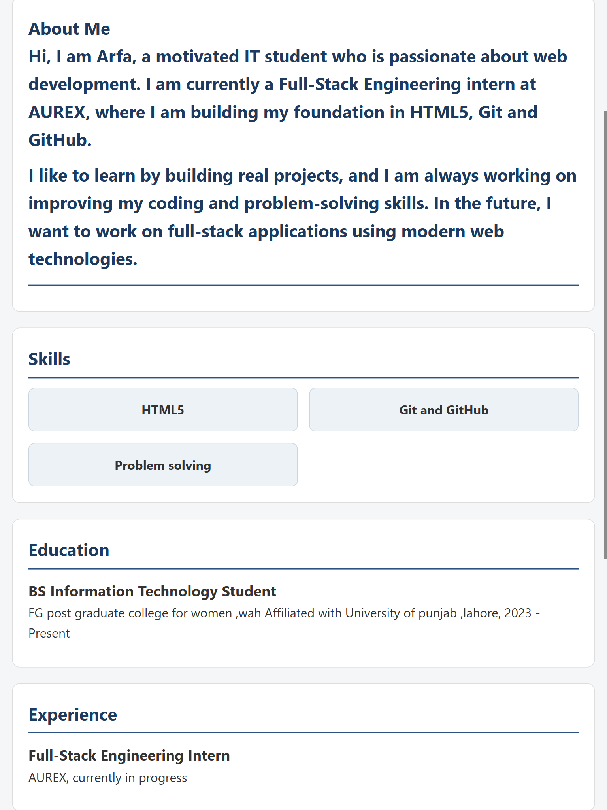
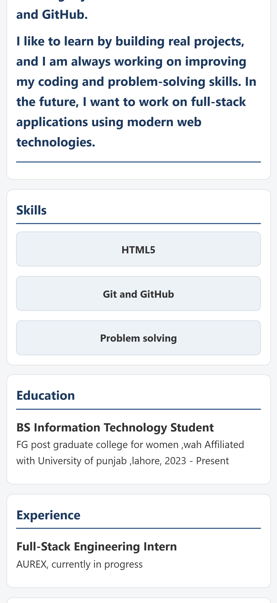

# AUREX Web Internship - Week 1

**Intern Name:** Arfa Mahnoor
**Domain:** Full-Stack Web Development
**Week:** Week 1

## Task Description

Created a personal profile webpage using only HTML5 (no CSS), and set up a GitHub repository using Git and VS Code.

## Technologies Used

- HTML5
- Git
- GitHub

## How to Run the Project Locally

1. Download or clone this repository.
2. Open the folder and double-click `index.html`.
3. The page will open in your browser.

## Key Learnings

- How to install and set up VS Code, Git and GitHub
- Basic Git commands: init, add, commit, push
- Structuring a page with semantic HTML tags like header, nav, main, section and footer
- Using proper heading hierarchy (h1, h2, h3)
- Connecting form inputs with labels for accessibility

## Difficulties / Blockers

- At first, my commit did not work because I forgot to run `git add` before `git commit`. I learned that a file must be added first before it can be committed.
- I was confused about how to connect my local folder to the GitHub repository. I solved it using `git remote add origin`.

---

# Week 2: CSS, Flexbox/Grid and Responsive Design

**Intern Name:** Arfa Mahnoor
**Domain:** Full-Stack Engineering Internship (AUREX)
**Week:** Week 2 (Month 1: Frontend Foundation)

## Live Deployment

https://arfamahnoor.github.io/aurex-web-internship-arfa/

## Task

Converted my Week 1 HTML profile page into a modern, responsive portfolio using CSS3.

## CSS Features Implemented

- Colors, backgrounds, fonts and text styling
- Element and class selectors
- Box model (padding, margin, border, border-radius, box-sizing)
- Hover effect on navigation links
- Styled contact form (inputs, labels and button)

## Layout Techniques

- **Flexbox:** used for the navigation bar (centered, with gap and wrapping)
- **CSS Grid:** used for the skills section (3 columns on desktop, 2 on tablet, 1 on mobile)

## Responsive Design

- Added the viewport meta tag
- Used media queries for tablet (max-width: 768px) and mobile (max-width: 480px)
- Skills grid, font sizes, spacing and buttons adjust for smaller screens

##

### Desktop


### Tablet



### Mobile



## Key Learnings

- I learned how the box model works (content, padding, border, margin)
- I learned the difference between Flexbox and CSS Grid
- I learned how media queries change the layout for different screen sizes
- I learned how to publish a website live using GitHub Pages

## Challenges Faced

- Understanding when to use Flexbox and when to use Grid
- Making the layout look good on mobile screens
- Setting up GitHub Pages (the repository had to be public and the site took a few minutes to go live)
- Opening browser DevTools on my laptop to test responsive views

---

# Week 3: Advanced CSS, Animations and UI Polish

**Name:** Arfa Mahnoor
**Domain:** Full-Stack Engineering Internship (AUREX), Month 1: Frontend Foundation
**Week:** Week 3

## Live Deployment

https://arfamahnoor.github.io/aurex-web-internship-arfa/

## What I Built

I upgraded my Week 2 portfolio into an interactive and animated page. I added a Projects gallery, CSS variables, hover effects, keyframe animations and fluid typography.

## CSS Grid Layouts

- **Projects gallery:** built with `grid-template-columns: repeat(auto-fit, minmax(220px, 1fr))`. Cards automatically fit as many columns as the screen allows, so it needs no extra media query.
- **Grid template areas:** on screens 900px and wider, the 4 project cards use `grid-template-areas` so the first and fourth cards are wide and the others are narrow.
- **Skills section:** a 3-column grid that changes to 2 columns on tablet and 1 column on mobile.
- **Flexbox:** used for the navigation bar.

## Transitions and Keyframe Animations

- **Card hover elevation:** project cards lift up with a bigger shadow using `transform: translateY(-8px)`.
- **Skills hover:** boxes scale up and change colour.
- **Navbar and button transitions:** smooth colour change and scale effect on hover, with a press effect on click.
- **Input focus glow:** form fields get a purple glow when selected.
- **`fadeInUp` keyframes:** the header and sections fade in from below when the page loads, with staggered delays.
- **`pulseGlow` keyframes:** a soft pulse around the Send button.
- Animations are turned off for users who have `prefers-reduced-motion` enabled.

## UI Polish

- CSS variables (colours, spacing, radius, shadow, transition) defined in `:root`.
- Fluid headings with `clamp()`.
- Separate files for structure: `main.css` for layout and style, `animations.css` for transitions and keyframes.

## Testing Results

| Test                          | Result                                             |
| ----------------------------- | -------------------------------------------------- |
| Desktop browser (live site)   | Works, grid areas layout and animations are smooth |
| Tablet size (Chrome DevTools) | Works, skills show in 2 columns                    |
| Mobile size (Chrome DevTools) | Works, cards stack in one column                   |
| Horizontal scrollbar          | None at any screen size                            |
| Live GitHub Pages site        | All animations and grid layouts render correctly   |

## Screenshots

### Desktop


### Tablet


### Mobile


### Card Hover


### Skills Hover


### Demo GIF


## Folder Structure

```
├── index.html
├── styles/
│   ├── main.css
│   └── animations.css
├── screenshots/
└── README.md
```
